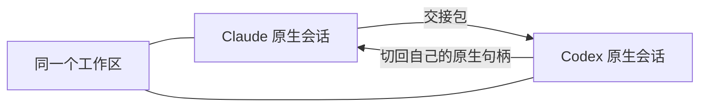

# omni · 同文

> 原生 coding agent 的接力工作台。

**一家卡住，换一家接着干。**

在 Claude Code、Codex、Kimi Code、Grok 与 DSH 之间延续同一件工作。omni 会把目标、
已改文件、执行过的命令、人工裁决和未完成项交给下一家；每一家仍运行自己的原生进程，
使用自己的登录、模型、配置和工具。

接力之后也可以切回来——上一家自己的原生会话句柄仍然保留。omni 管的是一条工作的连续性，
不是把多家 agent 编成一支自动协作的队伍。

目前内置五家：Codex、Claude Code、Kimi Code、Grok 与 DSH；其他讲 ACP 的引擎也可以注册。

## 为什么需要接力

coding agent 各有所长，也都会遇到自己的问题：

- 一家卡在某个错误上，想换另一家重新判断
- 用一家梳理方案，再让另一家接着实现
- 当前引擎额度不足、服务异常，或者不适合眼前这个阶段
- 想让另一家从头再试，同时保留原来的结果

通常这意味着重开窗口、重新选择项目、复述背景，再解释哪些文件已经改过。
omni 把这些动作收进同一条工作线。

## 接力怎么工作



接力不等于把一家模型的上下文翻译成另一家的私有 session 格式。

| 会交给下一家 | 不会搬运 |
| --- | --- |
| 当前目标与追加要求 | 隐藏推理与私有模型上下文 |
| 已改动的文件 | 原始 transcript 的全部过程噪声 |
| 成功执行过的命令 | 凭证与登录信息 |
| 人工做过的裁决 | 对方引擎的 session 文件 |
| 尚未完成的计划项 | omni 猜测出来的状态 |

工作区是真源，接手的引擎会自行核对代码后继续。

## 三种换法

1. **从合适的一家开始**：新工作直接选择引擎。
2. **让另一家接着做**：带着交接包继续当前工作线。这是 omni 的核心。
3. **换一家从头再试**：只传目标，保留原结果，让另一家独立完成一次。

第三种不会附带「已改过哪些文件」——否则另一家会误以为工作已经做了一半。
两边的结果目前靠侧栏切换查看，还没有并排对比视图。

## “原生”意味着什么

omni 启动的是你本机已经安装并登录过的 coding agent：

- **不另外索要或代管凭证。** 没有 omni 自己的 API key、OAuth 或 token 仓库。
- **不代理模型请求。** 请求由各家原生进程直接发出。
- **不重写 agent loop、提示词或工具。** 各家的上游升级会被原样继承。
- **不替引擎猜能力和状态。** 引擎报告什么，界面就展示什么；分辨不出就明确说不知道。
- **只读配置，不碰凭证。** omni 会读取配置文件，以说明项目里哪些指令与钩子正在生效；
  凭证文件一律不读。

源码仓库不包含任何一家的二进制。Claude 完整版使用官方 Agent SDK 提供的平台可执行文件；
轻量版则使用 `PATH` 上已有的 `claude`。

如果你要的是统一模型网关、自己实现的 agent harness，或自动多 agent 编排，omni 不是那个产品。

## 一条工作线里有什么

- **统一会话**：正文、计划、工具调用、用量、错误和引擎状态用同一套界面呈现
- **审批与信任档**：不同引擎的原生审批进入同一套可追溯的人工裁决
- **真实变更**：从 git 工作区生成变更汇总与只读审核面板，不只相信引擎自报的编辑
- **终端与项目**：在同一个工作区里查看代码、运行命令和继续 agent 会话
- **断点续跑**：事件落盘、原生句柄恢复、正文搜索与跨会话回看
- **远程接管**：从手机或浏览器查看进度、继续对话、处理审批并接收通知

## 适合谁

omni 适合同时使用两家以上原生 coding agent、希望保留各家订阅与配置，
又不想每次切换都重新交代工作的开发者。

它不适合需要统一模型 API、云端 IDE、自动并行 agent 团队，或者纯命令行工作流的人。
omni 唯一的用户界面是 GUI；命令行只用于开发和打包。

## 支持的引擎

| 引擎 | 原生入口 | 状态 |
| --- | --- | --- |
| Codex | `codex app-server --stdio` | 内置 |
| Claude Code | Agent SDK | 内置 |
| Kimi Code | `kimi web` REST + WebSocket | 内置 |
| Grok | ACP | 内置 |
| DSH | `dsh --profile acp`（ACP） | 内置；原生配置完成后在设置中确认接入 |
| 其他 ACP 引擎 | `engines.json` 注册 | 按引擎自报能力接入 |

内置引擎会显示真实探测状态；DSH 在设置中确认原生配置完成后才进入清单，
用户自配的 ACP 引擎则只有注册后才会出现。

## 跑起来

```sh
pnpm install
pnpm dev          # 开发模式
pnpm check        # typecheck / lint / 架构守卫 / 日志守卫 / 测试
pnpm dist         # 完整版 .dmg：内置 Claude 平台可执行文件
pnpm dist:thin    # 轻量版 .dmg：使用 PATH 上的 claude
pnpm dist:all     # 一次生成两种
```

前置条件：机器上装好要使用的原生 agent（`codex` / `kimi` / `grok` / `dsh`）并按各家方式完成登录；
Claude 完整版内置 SDK 对应的平台可执行文件，轻量版要求 `claude --version` 可运行。
DSH 还要求在 DSH Web 的 Models 设置里配好 provider、model 与 API 凭证，并让 `dsh --profile acp`
能完成 ACP 握手；之后在 omni 的设置 → 引擎中确认接入。profile、凭证与插件版本仍由 DSH 自己管理。
omni 直接使用各家的原生登录态，不另外配置密钥。

当前打出来的包没有签名（`identity: null`）。首次打开要在
「系统设置 → 隐私与安全性」里放行，或者运行：

```sh
xattr -dr com.apple.quarantine /Applications/omni.app
```

远程访问的配对、隧道与设备吊销见 [`docs/远程访问设置.md`](docs/远程访问设置.md)。

## 架构与开发

```
packages/
  protocol/   领域模型 thread / turn / item（零依赖，纯类型）
  approval/   信任档 + 红线表 + 判定器（纯函数，零 IO）
  store/      事件流到视图状态的纯归约器
  wire/       序号、重放、分片与补洞
  engine/     原生引擎驱动：acp / codex / claude / kimi
  worksite/   工作区安全：git guard、写范围
  journal/    持久化、断点、恢复
  handoff/    跨引擎交接包
  host/       会话编制与进程生命周期
apps/
  desktop/    Electron 壳 + React 渲染层
  web/        远程浏览器端
```

精确依赖边由 `pnpm arch` 强制，依赖增删必须同步改真源：

<!-- package-graph:start -->
```text
protocol ← ∅
approval ← protocol
store ← protocol
wire ← protocol
worksite ← ∅
journal ← protocol
handoff ← protocol
engine ← protocol + approval
host ← protocol + approval + engine + store + journal + handoff
desktop ← protocol + engine + handoff + host + journal + store + wire + worksite
web ← protocol + store + wire
```
<!-- package-graph:end -->

```sh
pnpm check       # 提交前必须全绿
pnpm test:watch
```

工程规范见 [`AGENTS.md`](AGENTS.md)。名字取自「书同文」——多家写法，一条工作线。
